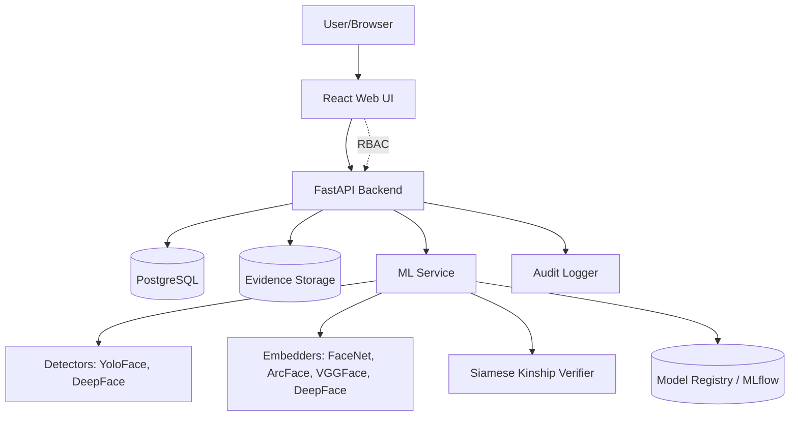
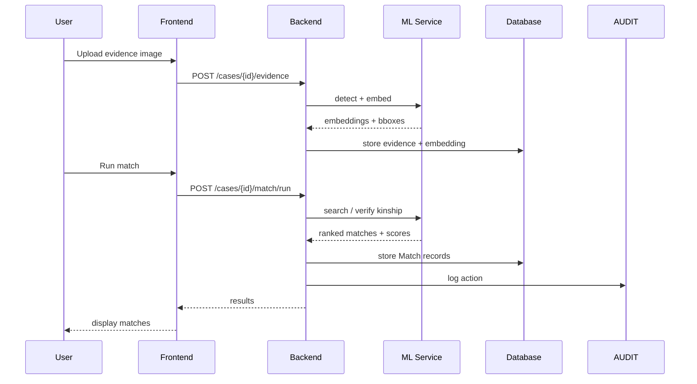
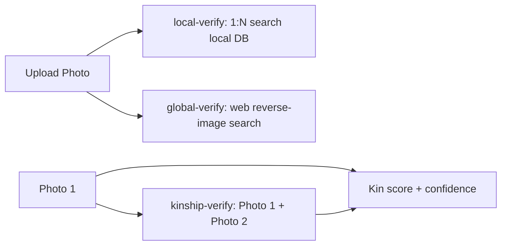
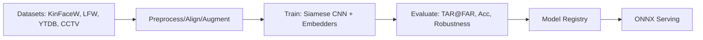

# Visuals

## System Architecture



## Technical Workflow (Match Request)



## Verify Screens (3 flows)



### local-verify
```
[Upload Photo] → [Detect faces] → [Embed] → [1:N search MySQL evidence embeddings] → [Ranked match results w/ score + case link]
```

### global-verify
```
[Upload Photo] → [Detect faces] → [Embed] → [Reverse-image search across web engines/APIs] → [Similar faces w/ source URLs + similarity score]
```

### kinship-verify
```
[Photo 1 + Photo 2] → [Detect faces] → [Embed both] → [Siamese verifier] → [Kin/non-kin score + confidence]
```

## Reporter Registration & Case Flow (Family & Community Support)

```mermaid
flowchart LR
    R[Reporter Register] --> R1[POST /auth/register (role: reporter)]
    R1 --> R2[POST /reporter/cases (missing person report + photos/evidence)]
    R2 --> R3[Case created, pending investigator review]
    R3 --> R4[GET /reporter/cases/{id}/status (read-only view)]
    R4 --> R5[POST /reporter/cases/{id}/evidence (add more evidence)]
```

## Reporter RBAC Permissions

| Role | Can register | Can create cases | Can upload evidence | Can run matches | Can view audit | Can manage users |
|---|---|---|---|---|---|---|
| Admin | — | Yes | Yes | Yes | Yes | Yes |
| Investigator | — | Yes (own) | Yes | Yes | Yes | No |
| Reviewer | — | No | No | No | Yes (read-only) | No |
| Reporter | Yes | Yes (own) | Yes (own) | No (read results only) | No | No |

## Main Navigation & Case Screen

```mermaid
flowchart LR
    L[Login/MFA] --> D[Dashboard: Cases]
    D --> C[Case Detail]
    C --> E[Evidence Upload]
    C --> M[Match Results]
    C --> K[Kinship Pairs]
    D --> V[Verify: local/global/kinship]
    D --> U[User Management (Admin)]
    D --> A[Audit Log]
```


```
+--------------------------------------------------+
| TopBar: FMPPI | User (role) | Logout            |
+--------------------------------------------------+
| Sidebar: Dashboard | Cases | Verify | Users | Audit |
+-------------------+------------------------------+
| Case List         | Case Detail / Match Results   |
| - filters/search  | - Person info + Evidence      |
| - status          | - local/global/kinship results|
+-------------------+------------------------------+
```



